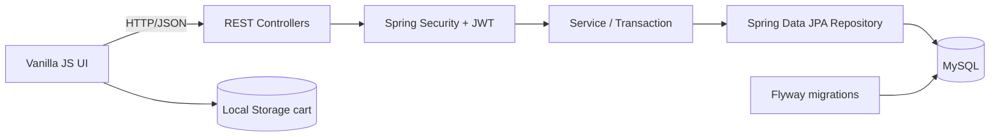

# Mộc Nhiên Coffee Order

Website đặt hàng cà phê phục vụ đồ án Thực tập cơ sở ngành. Dự án mô phỏng đầy đủ luồng
xem thực đơn, tùy chọn món, giỏ hàng, áp mã giảm giá, đặt hàng COD, theo dõi đơn và quản trị
vận hành. Thương hiệu, nội dung và dữ liệu minh họa được xây dựng riêng cho Mộc Nhiên Coffee.

## Mục lục

- [Chức năng](#chức-năng)
- [Công nghệ](#công-nghệ)
- [Kiến trúc](#kiến-trúc)
- [Mô hình dữ liệu](#mô-hình-dữ-liệu)
- [Cấu trúc dự án](#cấu-trúc-dự-án)
- [Cài đặt và chạy local](#cài-đặt-và-chạy-local)
- [Tài khoản và dữ liệu demo](#tài-khoản-và-dữ-liệu-demo)
- [API chính](#api-chính)
- [Kiểm thử](#kiểm-thử)
- [Cấu hình môi trường](#cấu-hình-môi-trường)
- [Trạng thái và giới hạn](#trạng-thái-và-giới-hạn)

## Chức năng

### Khách hàng

- Đăng ký, đăng nhập bằng email và đăng xuất ở frontend.
- Xem danh mục, danh sách và chi tiết sản phẩm đang bán.
- Tìm sản phẩm theo tên và kết hợp bộ lọc danh mục theo thời gian thực.
- Chọn size, topping, mức đá, mức đường, số lượng và ghi chú riêng cho món.
- Thêm, tăng/giảm số lượng và xóa sản phẩm trong giỏ hàng lưu bằng `localStorage`.
- Áp coupon `PERCENT` hoặc `FIXED`; kiểm tra trạng thái, hạn dùng, giá trị đơn tối thiểu và
  mức giảm tối đa.
- Checkout COD với họ tên, số điện thoại, địa chỉ và ghi chú giao hàng.
- Giá món, phụ thu, giảm giá, phí giao hàng và tổng tiền được backend tính lại trước khi lưu.
- Phí giao mặc định 15.000 VNĐ; miễn phí từ 200.000 VNĐ và có thể cấu hình bằng biến môi trường.
- Tra cứu đơn bằng mã đơn và xem tiến trình trạng thái.
- Người dùng đăng nhập xem được lịch sử đơn cá nhân và chỉ được hủy đơn của mình khi còn
  `PENDING`.
- Giao diện responsive, drawer giỏ hàng, modal chi tiết sản phẩm và thông báo toast.

### Quản trị

- Dashboard hiển thị tổng đơn, doanh thu từ đơn `COMPLETED`, số đơn theo trạng thái, sản phẩm,
  người dùng và năm đơn gần nhất.
- CRUD danh mục; không cho xóa danh mục còn sản phẩm.
- CRUD sản phẩm; thao tác xóa chuyển sản phẩm sang trạng thái ẩn để bảo toàn lịch sử đơn.
- CRUD topping và coupon.
- Xem chi tiết, tìm đơn theo mã/tên/số điện thoại và lọc theo trạng thái hoặc khoảng ngày.
- Cập nhật đơn theo luồng hợp lệ:

```text
PENDING ──> CONFIRMED ──> DELIVERING ──> COMPLETED
   │             │
   └─────────────┴──────────────────────> CANCELLED
```

- Khu vực quản trị và API `/api/v1/admin/**` được bảo vệ bằng quyền `ADMIN`.

### Dữ liệu và vận hành

- Flyway quản lý schema và index database qua migration có version.
- API trả response DTO ổn định thay vì serialize trực tiếp JPA Entity hoặc quan hệ nội bộ.
- Seed demo chỉ chạy với profile `dev` hoặc `demo`, không chạy trong production.
- Có profile riêng cho phát triển, demo, kiểm thử và production.
- Swagger UI/OpenAPI hỗ trợ khám phá và thử REST API.
- Có hướng dẫn sao lưu, khôi phục và kiểm tra database trước migration.

## Công nghệ

| Thành phần | Công nghệ |
| --- | --- |
| Frontend | HTML5, CSS3, Vanilla JavaScript, Fetch API, Local Storage |
| Backend | Java 17, Spring Boot 4.1.1, Spring Web MVC |
| Persistence | Spring Data JPA, Hibernate, MySQL |
| Migration | Flyway Core, Flyway MySQL |
| Bảo mật | Spring Security, JWT với JJWT 0.12.6, BCrypt cost 12 |
| Validation | Jakarta Bean Validation |
| API docs | Springdoc OpenAPI, Swagger UI |
| Build | Maven Wrapper |
| Testing | JUnit 5, Mockito, Spring Boot test starters |
| Hỗ trợ code | Lombok |

Frontend không cần Node.js hoặc bước build. Backend cung cấp REST API JSON tại tiền tố
`/api/v1`; frontend gọi API bằng Fetch và lưu JWT/giỏ hàng trong trình duyệt.

## Kiến trúc



Backend theo kiến trúc phân tầng:

| Tầng | Trách nhiệm |
| --- | --- |
| `controller` | Khai báo endpoint, nhận request, validation và trả `ApiResponse` |
| `service` | Nghiệp vụ xác thực, catalog, coupon, tính giá, đơn hàng và dashboard |
| `repository` | Truy vấn dữ liệu bằng Spring Data JPA và JPQL |
| `model` | JPA Entity, enum quyền, loại coupon và trạng thái đơn |
| `dto` | Request/response cho auth, hồ sơ, đơn, coupon và dashboard |
| `security` | Tạo/kiểm tra JWT, nạp người dùng và filter xác thực stateless |
| `config` | Security, CORS và cấu hình typed cho JWT/phí giao hàng |
| `exception` | Xử lý lỗi tập trung cho REST API |
| `seeder` | Dữ liệu mẫu chỉ dành cho `dev`/`demo` |

Luồng đặt hàng chính:

1. Frontend đọc catalog và lưu lựa chọn món trong `localStorage`.
2. Checkout gửi ID sản phẩm, size, topping và số lượng lên backend.
3. Backend đọc giá hiện hành từ database, kiểm tra lựa chọn và tự tính toàn bộ đơn.
4. Coupon và phí giao hàng được xác thực ở service; frontend không quyết định tổng tiền cuối.
5. Đơn lưu snapshot tên sản phẩm, đơn giá, tùy chọn, giảm giá, phí giao và tổng tiền.

## Mô hình dữ liệu

| Bảng | Nội dung và quan hệ chính |
| --- | --- |
| `users` | Tài khoản, mật khẩu BCrypt và quyền `CUSTOMER`/`ADMIN` |
| `categories` | Danh mục sản phẩm, liên kết một-nhiều với `products` |
| `products` | Sản phẩm, giá cơ bản, ảnh, trạng thái bán và danh mục |
| `product_sizes` | Size và phụ thu theo sản phẩm |
| `toppings` | Topping và giá phụ thu |
| `coupons` | Mã giảm giá, loại, giá trị, điều kiện và hạn dùng |
| `orders` | Người nhận, trạng thái và snapshot tổng tiền; có thể gắn với `users` |
| `order_items` | Snapshot sản phẩm, size, topping, đá/đường, giá và số lượng |

Index được tạo cho mã đơn, thời gian/trạng thái đơn, email người dùng, tên sản phẩm và mã coupon.

## Cấu trúc dự án

```text
.
├── backend/
│   ├── src/main/java/com/highlands/order/
│   │   ├── config/           # Security, CORS, typed properties
│   │   ├── controller/       # REST API public/customer/admin
│   │   ├── dto/              # Request và response DTO
│   │   ├── exception/        # Global exception handling
│   │   ├── model/            # JPA Entity và enum
│   │   ├── repository/       # Spring Data JPA
│   │   ├── security/         # JWT filter/service
│   │   ├── seeder/           # Dữ liệu demo theo profile
│   │   └── service/          # Nghiệp vụ và transaction
│   ├── src/main/resources/
│   │   ├── db/migration/     # Flyway V1, V2...
│   │   └── application*.yml  # Cấu hình chung và từng profile
│   ├── src/test/             # Unit test
│   ├── mvnw / mvnw.cmd
│   └── pom.xml
├── frontend/
│   ├── css/                  # Style chung và modal
│   ├── js/                   # API client, catalog, cart, checkout, admin
│   ├── index.html            # Storefront
│   ├── checkout.html
│   ├── order-status.html
│   ├── my-orders.html
│   ├── login.html / register.html
│   └── admin.html
├── docs/
│   ├── README.md             # Mục lục tài liệu
│   ├── roadmap.md            # Lộ trình sản phẩm
│   ├── work-packages.md      # Phase 1: 15 PR / 30 commit
│   ├── security-auth-*.md    # Phase 2: email/JWT/RBAC/MFA
│   ├── team-plan-*.md        # Phương án 3 hoặc 5 thành viên
│   ├── git-workflow.md       # Quy trình branch/commit/PR
│   ├── templates/            # Mẫu issue, PR và handoff
│   └── skills/               
├── .env.example
├── AGENTS.md                 # Chỉ dẫn tải Git-flow skill
└── README.md
```

## Cài đặt và chạy local

### Yêu cầu

- JDK 17.
- MySQL 8.x đang chạy.
- Trình duyệt hiện đại.
- Live Server hoặc một static HTTP server được khuyến nghị cho frontend.

Không cần cài Maven toàn cục vì repository đã có Maven Wrapper.

### 1. Tạo cấu hình môi trường

Từ thư mục gốc dự án:

```powershell
Copy-Item .env.example .env
```

Mở `.env` và thiết lập tối thiểu:

```dotenv
SPRING_PROFILES_ACTIVE=demo
DB_URL=jdbc:mysql://localhost:3306/coffee_order_db?createDatabaseIfNotExist=true&useSSL=false&allowPublicKeyRetrieval=true&serverTimezone=UTC
DB_USERNAME=root
DB_PASSWORD=your_password
JWT_SECRET=your_base64_secret
```

`JWT_SECRET` phải là chuỗi Base64 sinh từ ít nhất 32 byte ngẫu nhiên. Không commit `.env` hoặc
secret thật lên Git.

### 2. Chạy backend

```powershell
Set-Location backend
.\mvnw.cmd spring-boot:run
```

Khi khởi động, Flyway chạy migration trước rồi Hibernate kiểm tra/cập nhật schema theo profile.
Các địa chỉ mặc định:

- API: `http://localhost:8080/api/v1`
- Swagger UI: `http://localhost:8080/swagger-ui.html`
- OpenAPI JSON: `http://localhost:8080/v3/api-docs`

### 3. Chạy frontend

Mở thư mục `frontend` bằng Live Server, hoặc dùng static server bất kỳ. Điểm vào chính:

- Storefront: `frontend/index.html`
- Quản trị: `frontend/admin.html`
- Checkout: `frontend/checkout.html`
- Lịch sử đơn: `frontend/my-orders.html`

Frontend hiện dùng URL API trong `frontend/js/api.js`. Khi backend chạy ở host/port khác, cập
nhật hằng `API_BASE_URL` trong file này.

## Tài khoản và dữ liệu demo

Profile `demo`/`dev` tạo dữ liệu khi database chưa có danh mục, gồm 6 danh mục, 22 sản phẩm,
5 topping, 3 coupon, 4 tài khoản và 9 đơn ở nhiều trạng thái.

| Vai trò | Email | Mật khẩu |
| --- | --- | --- |
| Admin | `admin@mocnhien.vn` | `admin123` |
| Customer | `nguyen.van.a@gmail.com` | `123456` |
| Customer | `tran.thi.b@gmail.com` | `123456` |
| Customer | `le.van.c@gmail.com` | `123456` |

Các tài khoản trên chỉ dùng cho local/demo và không được đưa vào production.

Coupon mẫu: `WELCOME10`, `MOCNHIEN20K`, `FREESHIP15K`.

## API chính

Response thành công hiện có dạng:

```json
{
  "success": true,
  "message": "Success",
  "data": {},
  "errorCode": null,
  "timestamp": "2026-10-13T10:46:27Z",
  "path": null
}
```

Trường `data` sử dụng response DTO theo từng tài nguyên. Response đơn hàng chỉ chứa snapshot
cần cho giao diện và không serialize tài khoản, email hay `passwordHash` từ JPA Entity.
Response lỗi dùng cùng envelope, kèm mã lỗi ổn định và URI request; xem
[hợp đồng API và lỗi](docs/api-contract.md).

| Nhóm | Method và endpoint | Quyền | Chức năng |
| --- | --- | --- | --- |
| Auth | `POST /api/v1/auth/register` | Public | Đăng ký và nhận JWT |
| Auth | `POST /api/v1/auth/login` | Public | Đăng nhập và nhận JWT |
| Profile | `GET, PUT /api/v1/users/me` | Customer/Admin | Xem, cập nhật hồ sơ |
| Catalog | `GET /api/v1/categories` | Public | Danh sách danh mục |
| Catalog | `GET /api/v1/products` | Public | Lọc theo `categoryId`, `keyword` |
| Catalog | `GET /api/v1/products/{id}` | Public | Chi tiết sản phẩm |
| Catalog | `GET /api/v1/toppings` | Public | Danh sách topping |
| Coupon | `POST /api/v1/coupons/validate` | Public | Kiểm tra và tính giảm giá |
| Order | `POST /api/v1/orders` | Public/JWT tùy chọn | Tạo đơn; tự gắn user nếu đăng nhập |
| Order | `GET /api/v1/orders/{orderCode}` | Public | Tra cứu đơn theo mã |
| Order | `GET /api/v1/orders/my-orders` | Authenticated | Lịch sử đơn của tài khoản |
| Order | `PATCH /api/v1/orders/{id}/cancel` | Authenticated | Hủy đơn `PENDING` thuộc tài khoản |
| Admin | `GET /api/v1/admin/dashboard` | Admin | Thống kê tổng quan |
| Admin | `/api/v1/admin/categories/**` | Admin | Tạo, cập nhật, xóa danh mục |
| Admin | `/api/v1/admin/products/**` | Admin | Liệt kê, tạo, cập nhật, ẩn sản phẩm |
| Admin | `/api/v1/admin/toppings/**` | Admin | Tạo, cập nhật, xóa topping |
| Admin | `/api/v1/admin/coupons/**` | Admin | CRUD coupon |
| Admin order | `GET /api/v1/orders/admin/all` | Admin | Tìm và lọc đơn |
| Admin order | `PATCH /api/v1/orders/admin/{id}/status` | Admin | Cập nhật trạng thái |

Gửi JWT qua header:

```http
Authorization: Bearer <token>
```

## Kiểm thử

Chạy bộ test backend:

```powershell
Set-Location backend
.\mvnw.cmd clean test
```

Bộ test hiện có 16 test method cho service đơn hàng, seeder, JWT filter, hợp đồng xử lý lỗi và
response DTO. Test tính giá đầy đủ, controller test và integration test với MySQL vẫn nằm trong
roadmap P0.

## Cấu hình môi trường

| Biến | Mặc định | Ý nghĩa |
| --- | --- | --- |
| `SERVER_PORT` | `8080` | Cổng backend |
| `SPRING_PROFILES_ACTIVE` | `demo` trong `.env.example` | Profile chạy ứng dụng |
| `DB_URL` | MySQL local `coffee_order_db` | JDBC URL |
| `DB_USERNAME` | `root` | Tài khoản database |
| `DB_PASSWORD` | rỗng | Mật khẩu database |
| `JWT_SECRET` | không có | Base64 secret bắt buộc cho JWT |
| `JWT_EXPIRATION_MINUTES` | `120` | Thời hạn token |
| `SHIPPING_FEE` | `15000` | Phí giao hàng |
| `FREE_SHIPPING_THRESHOLD` | `200000` | Ngưỡng miễn phí giao |

| Profile | Hibernate `ddl-auto` | Flyway baseline | Seed demo |
| --- | --- | --- | --- |
| Mặc định | `validate` | Tắt | Không |
| `dev` | `update` | Version `0` khi cần | Có |
| `demo` | `update` | Version `0` khi cần | Có |
| `test` | `create-drop` | Tắt Flyway | Không |
| `prod` | `validate` | Tắt | Không |

Trước lần đầu áp migration lên database đã tồn tại, xem
[hướng dẫn sao lưu và khôi phục](docs/database-operations.md).

## Trạng thái và giới hạn

Các luồng MVP và quản trị chính đã hoạt động. Những hạng mục chưa hoàn tất hoặc chủ động nằm
ngoài phạm vi hiện tại:

- Chưa tích hợp thanh toán online, định vị/giao hàng thời gian thực hoặc tích điểm.
- Giỏ hàng khách vẫn lưu phía trình duyệt, chưa có cart backend đồng bộ đa thiết bị.
- Ảnh sử dụng URL/placeholder, chưa có upload Cloudinary.
- Tra cứu đơn public hiện chỉ dựa vào mã đơn; cần bổ sung số điện thoại hoặc token tra cứu trong P0.
- Hợp đồng lỗi, `errorCode` và metadata response vẫn đang được chuẩn hóa trong P0.
- CORS hiện phục vụ phát triển local và cần giới hạn origin trước khi deploy production.
- Chưa có môi trường deploy production và integration/E2E test hoàn chỉnh.

Toàn bộ kế hoạch, phương án chia việc và Git workflow được tập trung tại
[trung tâm tài liệu](docs/README.md).
