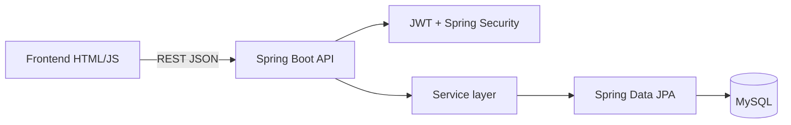

# Kiến trúc hệ thống

Frontend giữ giỏ hàng trong `localStorage`; backend là nguồn quyết định cuối cho giá, coupon, quyền và trạng thái đơn. Flyway quản lý schema trong `backend/src/main/resources/db/migration`.
