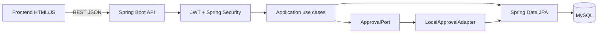

# Kiến trúc hệ thống

Frontend giữ giỏ hàng trong `localStorage`; backend là nguồn quyết định cuối cho giá, coupon, quyền và trạng thái đơn. Flyway quản lý schema trong `backend/src/main/resources/db/migration`.
Approval và fulfillment là hai state machine riêng.
`OrderStatus` chỉ còn là projection tương thích cho client cũ.
Local adapter giữ ứng dụng chạy độc lập; adapter DX-OS thuộc phase tích hợp sau và phải tuân thủ cùng `ApprovalPort`.
